<a href="https://github.com/talentUnion"><picture><source media="(prefers-color-scheme: dark)" srcset="assets/codex-head-dark.svg"></picture></a>
<a href="#"><picture><source media="(prefers-color-scheme: dark)" srcset="assets/codex-now-dark.svg"></picture></a>
<picture><source media="(prefers-color-scheme: dark)" srcset="assets/codex-contents-dark.svg"></picture>
<a href="#"><picture><source media="(prefers-color-scheme: dark)" srcset="assets/codex-work-1-dark.svg"></picture></a>
<a href="#"><picture><source media="(prefers-color-scheme: dark)" srcset="assets/codex-work-2-dark.svg"></picture></a>
<a href="#"><picture><source media="(prefers-color-scheme: dark)" srcset="assets/codex-work-3-dark.svg"></picture></a>
<a href="#"><picture><source media="(prefers-color-scheme: dark)" srcset="assets/codex-work-4-dark.svg"></picture></a>
<a href="https://github.com/talentUnion"><picture><source media="(prefers-color-scheme: dark)" srcset="assets/codex-activity-dark.svg"></picture></a>
<picture><source media="(prefers-color-scheme: dark)" srcset="assets/codex-foot-dark.svg"></picture>

